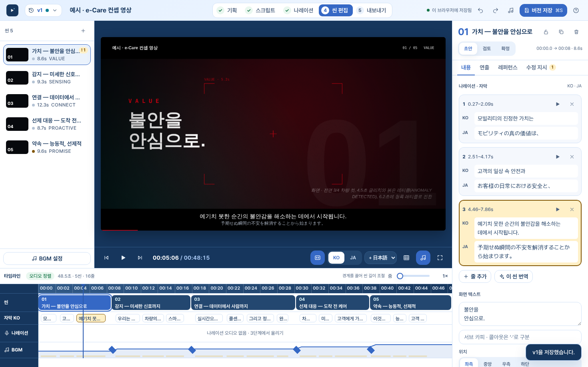

# Motion Brief Studio

모션그래픽을 **기획 → 스크립트 → 나레이션 → 씬 편집 → 내보내기** 순서로 다듬고, 출처 태그가 붙은 버전으로 관리하는 범용 제작 툴입니다. 결과물은 다른 Claude 작업에 그대로 넘길 수 있는 **제작 안내서(`brief.md`)**, 나레이션 텍스트, 애니마틱 MP4, 썸네일입니다.



## 디자인 시스템
화면은 **MapStone 디자인 시스템(Blue Infographic v1)** 을 따릅니다. 토큰(`ms-color-*`, `ms-space-*`, `ms-radius-*`, `ms-shadow-*`, 모션)은 `src/01_head.html`의 `:root`에 MapStone `tokens.json` 값 그대로 정의하고, 앱 내부 별칭(`--bg`, `--accent` …)은 모두 그 의미 토큰을 가리킵니다. 글꼴은 Pretendard Variable 하나(`dist/fonts/`), 라이트 테마 하나이며, 문구는 합니다체·과거형 토스트·`YYYY.MM.DD HH:mm` 날짜 형식을 씁니다.

애니마틱(영상) 안의 글꼴·색은 프로젝트별 비주얼 스타일 설정을 따르며 디자인 시스템과 별개입니다.

## 흐름

| 단계 | 하는 일 | 산출 |
|---|---|---|
| 1. 기획 | 주제·핵심 메시지·길이·화면비·비주얼 스타일·레퍼런스·BGM 성격 | brief |
| 2. 스크립트 | 씬별 나레이션(한 줄 = 자막 한 줄)·화면 텍스트·제작 의도, Claude 초안·번역·전체 수정 | scenes[] |
| 3. 나레이션 | Gemini TTS용 스타일 지시문·본문 복사 → 오디오 업로드 → 무음 구간 기반 자막·씬 타이밍 자동 맞춤 | narration.txt |
| 4. 씬 편집 | 애니마틱 미리보기, 분위기 프리셋·카메라·효과·전환, 스틸, 다국어 자막, 수정 지시, 타임라인 경계 드래그 | animatic |
| 5. 내보내기 | brief.md · ZIP 패키지 · SRT · 썸네일 · 애니마틱 MP4 녹화, 최종 결과물/수정본 가져오기 | brief.md · mp4 |

### Claude와 주고받기
`brief.md` 내보내기 → 다른 Claude 프로젝트에 제작 요청 → 최종 MP4·수정된 `brief.md` 가져오기 → 출처 태그(WEB / CLAUDE·WEB / CLAUDE CODE / CLAUDE CHAT / GITHUB / IMPORT)가 붙은 새 버전.
형식은 [docs/motion-brief-format.md](docs/motion-brief-format.md) 참고.

## 주요 기능
- **버전 기록**: 좌상단 버전 버튼 → 출처별 필터, 버전 비교(diff), 복원, 버전별 brief.md. 저장 시 에이전트·`repo@commit` 참조 기록
- **BGM 설정**: 프리셋 → 2D 무드 맵(에너지×밝기) → 장르·템포(탭 템포) → 씬별 에너지 곡선·임팩트 → 악기·보컬·피할 것·덕킹·페이드 → 음원 소스(합성/업로드/스톡). 한국어 브리프 + 영문 생성 프롬프트 자동 작성, WebAudio 분위기 스케치
- **자막**: 표시 토글, 한국어 기본 + 일본어·영어 주/보조 자막
- **AI(페이지 내 Claude 호출)**: 스크립트 초안, 씬 재작성(수정 지시 반영), 전체 수정, 번역 채우기. 잠긴 씬은 제외
- **단축키**: ⌘S 버전 저장 · ⌘Z/⇧⌘Z · Space 재생 · ↑↓ 씬 이동 · C 자막 · G 가이드 · H 기록 · B BGM · ? 도움말

## 구조

```
src/            페이지 조각 (스타일 → 마크업 → 스크립트 순서로 합쳐짐)
  01_head.html    <title>, 폰트, CSS 토큰·스타일
  02_shell.html   아이콘 스프라이트, 앱 골격
  03_core.js      유틸·어휘·데이터 모델·타임라인 계산·저장소 어댑터
  04_views.js     바인딩·저장·버전·홈/기획/스크립트/나레이션 화면
  05_edit.js      씬 편집 화면·인스펙터·타임라인
  06_render.js    캔버스 애니마틱 렌더러·플레이어·BGM 스케치(WebAudio)
  07_export.js    brief.md·SRT·ZIP·썸네일·MP4 녹화
  08_overlays.js  BGM 시트·버전 기록·가져오기·Claude 생성·도움말
  09_actions.js   예시 프로젝트·액션·이벤트·부팅
dist/index.html  빌드 결과 (claude.ai 아티팩트로 게시하는 단일 파일)
dist/fonts/      Pretendard Variable (SIL OFL, MapStone 디자인 시스템에서 가져옴) — 게시 때 함께 올림
scripts/build.sh src → dist 빌드 (node 필요)
docs/            안내서 형식, 스크린샷
```

```bash
./scripts/build.sh
```

## 실행 환경
claude.ai 아티팩트로 게시해 쓰도록 만들어졌습니다. 아티팩트 런타임 기능을 사용합니다.

| 기능 | 용도 |
|---|---|
| `db` | 프로젝트·작업본·버전 기록 (`projects/{id}`, `drafts/{id}`, `projects/{id}/versions/{vid}`) |
| `assets` | 스틸·레퍼런스·오디오(JSON 래핑)·영상 파일 |
| `sample` | 스크립트 초안·재작성·번역 |
| `downloads` | 파일 저장 |
| `user` | 버전 작성자 표시 |

아티팩트 밖(로컬 파일 등)에서 열면 **로컬 모드**로 동작해 브라우저 localStorage에만 저장되고 Claude 호출은 꺼집니다.

## 알려진 제약
- 오디오는 14MB, 영상·이미지는 20MB 이하 업로드
- MP4 녹화는 브라우저 MediaRecorder 지원에 따름 (미지원 시 WebM)
- 녹화 중에는 탭을 앞에 둬야 끊기지 않음
